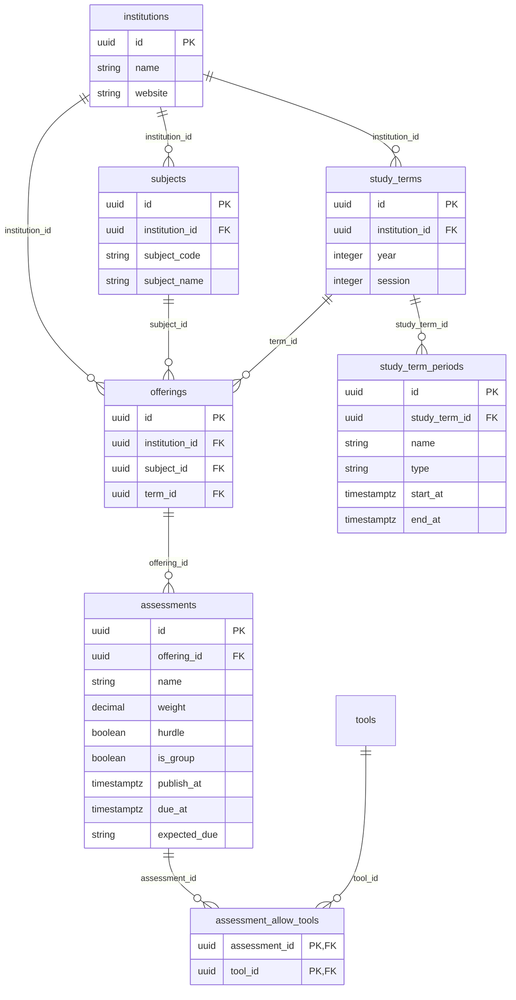
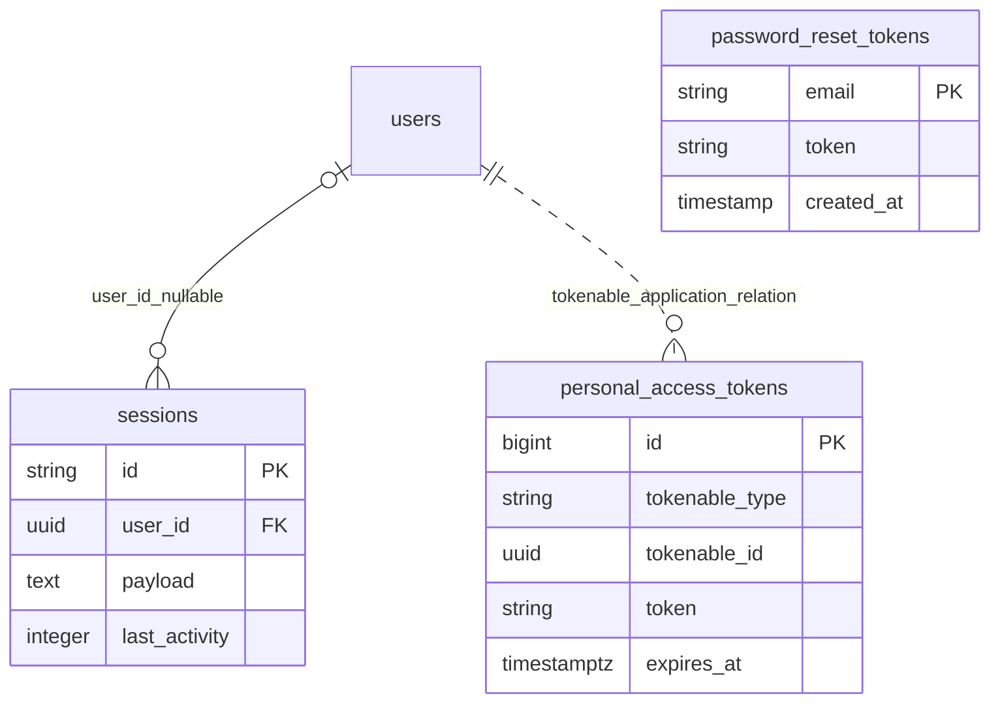
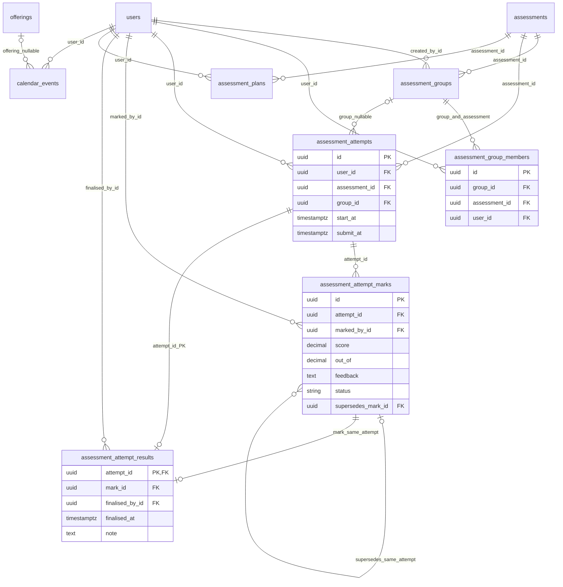
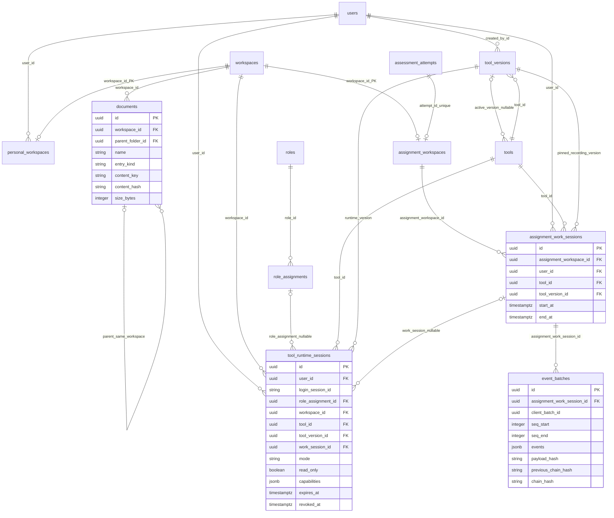

# Mô hình dữ liệu backend hiện tại

Tài liệu này đối chiếu các migration Laravel của backend ngày 30/10/2026. [File draw.io cũ](lernumi-erd.drawio) giữ thiết kế lịch sử; khi có khác biệt, lấy [migration](../server/database/migrations/) và tài liệu này làm mốc cho code hiện tại.

Các sơ đồ chia theo nghiệp vụ để dễ đọc; tên bảng lặp lại ở nhiều sơ đồ vẫn là cùng một bảng. Cột được ghi là các khóa và dữ liệu chính, không phải toàn bộ timestamps/index. `||` nghĩa là một, `o|` là không hoặc một, `o{` là không hoặc nhiều. Quan hệ có nhãn `nullable` cho phép chưa gắn bản ghi cha.

## Học vụ: institution → subject/term → offering → assessment

`Subject` là môn học trong danh mục. `StudyTerm` là học kỳ, nhận diện bằng institution + year + session. `StudyTermPeriod` là khoảng thời gian bên trong học kỳ, loại `TEACHING`, `BREAK` hoặc `EXAM`; nó không phải một lần mở môn.

`Offering` là một môn được mở trong một học kỳ. Ví dụ môn `COMP1000` mở ở Session 2/2026 là một offering. Database dùng khóa ngoại ghép để subject, term và offering cùng institution; mỗi cặp subject + term chỉ có một offering.

Assessment gắn vào offering, nên đề/bài và trọng số có thể khác khi môn mở ở kỳ khác. `publish_at` rỗng hoặc trong tương lai là bài chưa công bố. `expected_due` là mô tả thời điểm bằng văn bản khi chưa có deadline chính xác; `due_at` là thời điểm cụ thể. `assessment_allow_tools` là quan hệ nhiều–nhiều giữa bài và công cụ được phép sử dụng.

## Tài khoản và phân quyền

```mermaid
erDiagram
    institutions ||--o{ roles : institution_id
    roles ||--o{ role_permissions : role_id
    permissions ||--o{ role_permissions : permission_code
    roles ||--o{ role_inclusions : including_role_id
    roles ||--o{ role_inclusions : included_role_id
    roles ||--o{ role_request_visibilities : requestable_role_id
    roles ||--o{ role_request_visibilities : required_role_id
    users ||--o{ role_assignments : user_id
    roles ||--o{ role_assignments : role_id
    role_assignments ||--o{ scope_assignments : role_assignment_id
    offerings ||--o{ scope_assignments : offering_id
    offerings ||--o{ scope_assignment_codes : offering_id
    scope_assignment_codes o|--o| scope_assignments : code_nullable_unique
    users ||--o{ role_requests : user_id
    institutions ||--o{ role_requests : institution_id
    roles ||--o{ role_requests : role_id
    role_assignments o|--o| role_requests : approved_assignment_nullable_unique
    role_assignments ||--o{ scope_assignment_requests : role_assignment_id
    offerings ||--o{ scope_assignment_requests : offering_id
    scope_assignments o|--o| scope_assignment_requests : approved_scope_nullable_unique
    institutions o|--o{ access_audit_logs : institution_nullable
    users o|--o{ access_audit_logs : actor_nullable
```

| Bảng | Vai trò và khóa cần nhớ |
| --- | --- |
| `users` | UUID, email duy nhất, mật khẩu hash, trạng thái active/admin, avatar key |
| `permissions` | Khóa chính `code`; danh mục quyền do `PermissionCatalog` định nghĩa |
| `roles` | Role trong institution; `scope_type=INSTITUTION/OFFERING`, mã role duy nhất trong institution |
| `role_permissions` | Khóa chính ghép `(role_id, permission_code)` |
| `role_inclusions` | Khóa ghép `(including_role_id, included_role_id)`; service ngăn vòng và ghép role sai institution/phạm vi |
| `role_request_visibilities` | Role được xin và role điều kiện; dùng hai FK tới `roles` |
| `role_assignments` | Một user được gán role; `revoked_at` rỗng nghĩa là còn hiệu lực |
| `scope_assignments` | Các offering mà một assignment loại OFFERING được áp dụng |
| `scope_assignment_codes` | Mã cấp offering scope, chỉ lưu hash; có thời hạn/trạng thái dùng và thu hồi |
| `role_requests` | Xin role; duyệt xong liên kết `approved_assignment_id` |
| `scope_assignment_requests` | Xin thêm offering cho assignment; duyệt xong liên kết `approved_scope_assignment_id` |
| `access_audit_logs` | Actor, institution, action, subject UUID và metadata; `subject_id` là tham chiếu nghiệp vụ, không phải FK chung tới mọi bảng |

Các FK người cấp/thu hồi (`granted_by_id`, `revoked_by_id`), người tạo mã (`created_by_id`) và người xử lý request (`processed_by_id`) đều trỏ tới `users`; để sơ đồ dễ đọc, những đường actor lặp lại này được liệt kê ở đây. Actor có thể nullable theo migration. Partial unique index ngăn gán trùng role/scope còn hiệu lực và ngăn nhiều request `PENDING` cùng đích.

`sessions` là phiên đăng nhập database của Laravel, không phải work session của tool. Sanctum personal access token dùng cặp polymorphic `tokenable_type/tokenable_id`; đường nét đứt là quan hệ Eloquent, không có FK SQL từ tokenable tới users. `password_reset_tokens.email` cũng không có FK tới users; reset token và session được quản lý qua dịch vụ auth.

## Làm bài cá nhân/nhóm, chấm bài và lịch

Một assessment có nhiều attempt. Attempt cá nhân có `group_id=null`; attempt nhóm có group thuộc đúng assessment, người bắt đầu vẫn được lưu trong `user_id`. Một người chỉ ở một group cho mỗi assessment. API giữ nguyên danh sách thành viên sau khi group có attempt; mọi thành viên được coi là chủ chung của attempt/workspace.

Mark là một lượt chấm độc lập của một người. Mỗi marker chỉ có một `DRAFT` trên một attempt. Khi submit, bản chấm không còn sửa trực tiếp; sửa điểm tạo revision mới và liên kết `supersedes_mark_id`. Database bảo đảm revision và result đều tham chiếu mark của cùng attempt.

`assessment_attempt_results` dùng `attempt_id` làm khóa chính: mỗi attempt có tối đa một kết quả chính thức đang được chọn. Nộp một mark không tự công bố kết quả; người đủ quyền finalise chọn `mark_id` riêng. Lịch sử mark vẫn được giữ khi đổi kết quả.

`assessment_plans` có một dòng cho mỗi `(user_id, assessment_id)`, lưu `start_date/end_date` kiểu DATE. `calendar_events` lưu lịch cá nhân bằng timestamp có timezone; offering là tùy chọn và được đặt null nếu offering bị xóa. Database kiểm tra ngày kết thúc plan không trước ngày bắt đầu; event kết thúc sau bắt đầu và dài tối đa 24 giờ.

## Workspace, file và runtime công cụ

Workspace là phần chung. `personal_workspaces` và `assignment_workspaces` dùng `workspace_id` vừa là PK vừa là FK, thay vì tạo thêm một ID subtype. Luồng tạo trong service bảo đảm workspace có đúng một subtype; hiện không có CHECK SQL xuyên hai bảng để tự bảo đảm quy tắc XOR đó. Mỗi attempt được tạo workspace cùng transaction; khóa unique ngăn hai workspace cùng attempt.

`documents` chứa metadata của file/folder. Nội dung thực nằm trong storage riêng theo `content_key`; hash dùng cho ETag/If-Match. FK ghép giữ parent trong cùng workspace, unique index ngăn trùng tên cả ở root; service ngăn di chuyển folder vào hậu duệ và khóa ghi sau khi nộp bài.

`assignment_work_sessions` ghi ai đã mở tool, trong workspace nào, dùng version nào và lúc nào. Đây là dữ liệu ghi hình hoạt động của bài làm; personal workspace không tạo loại session này. `event_batches` lưu payload JSON cùng sequence và chuỗi hash; mỗi session + client batch ID là duy nhất để retry an toàn.

`tool_runtime_sessions` là quyền truy cập đang được cấp cho một runtime, gồm capability, chế độ owner/reviewer, version runtime và thời hạn. Personal runtime không có `work_session_id`; assignment/replay runtime liên kết work session. `login_session_id` chỉ là chuỗi được service kiểm tra với phiên đăng nhập khi có; cột này không có FK tới `sessions`.

Khi tạo recording, work session ghim version tool lúc làm bài. Khi mở replay, runtime chọn version đang active tại thời điểm mở; version ghi gốc vẫn giữ nguyên để kiểm tra khả năng tương thích. Refresh token của runtime đang mở giữ nguyên runtime version đã chọn.

Xem [API reference](api-reference.md), [hướng dẫn frontend](frontend-integration.md) và [migration workspace/runtime](../server/database/migrations/2026_10_30_000010_create_workspace_runtime.php) khi đi từ quan hệ dữ liệu sang endpoint cụ thể.
